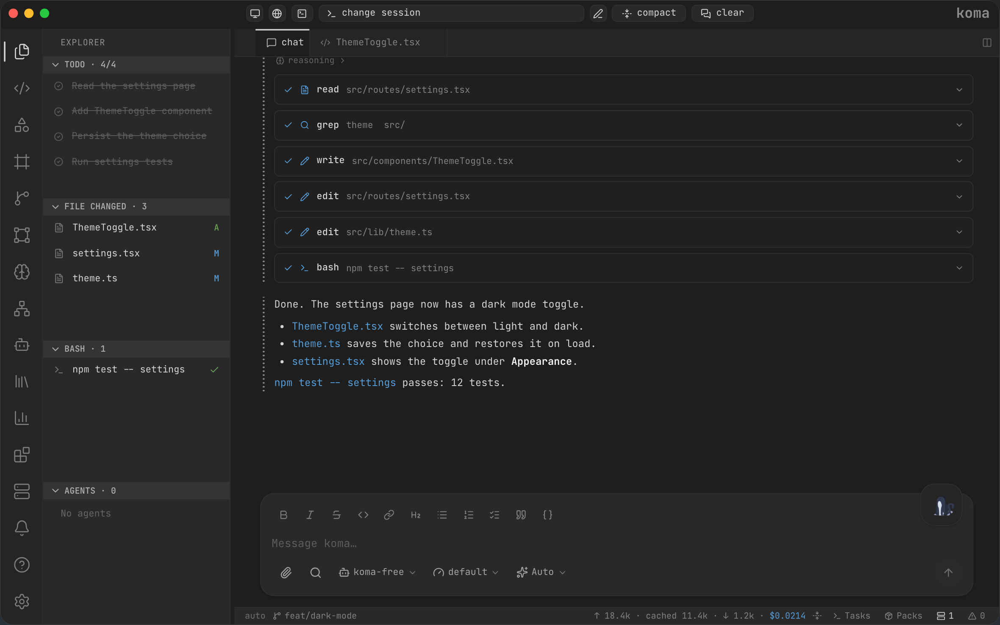
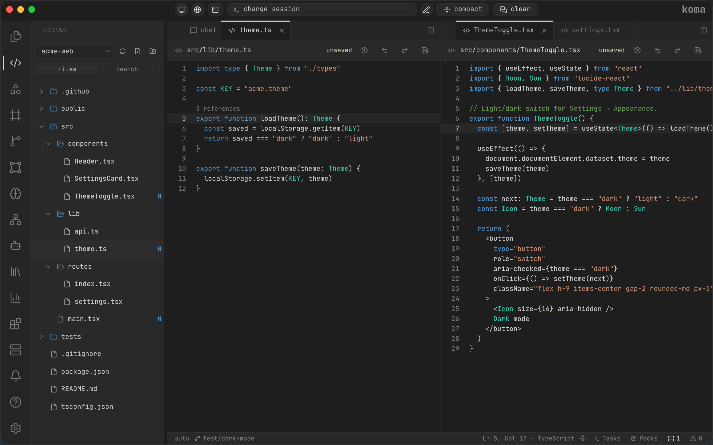
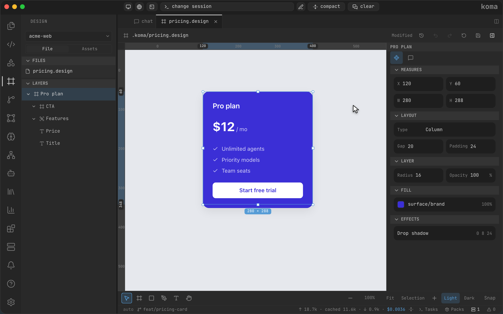
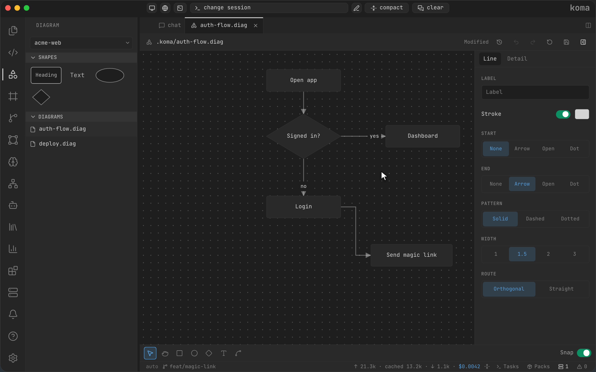
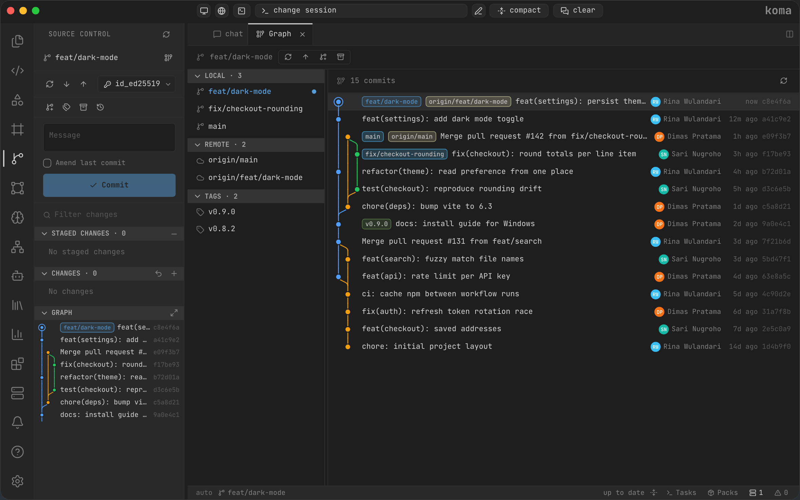
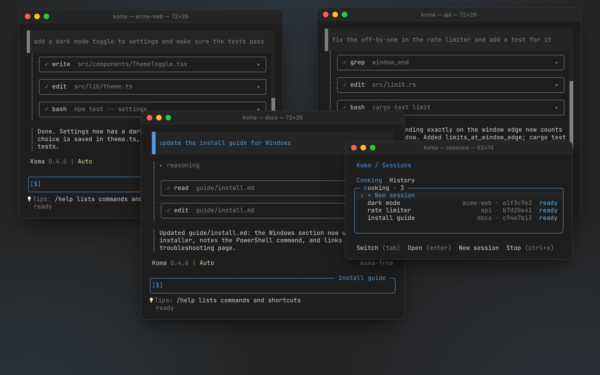
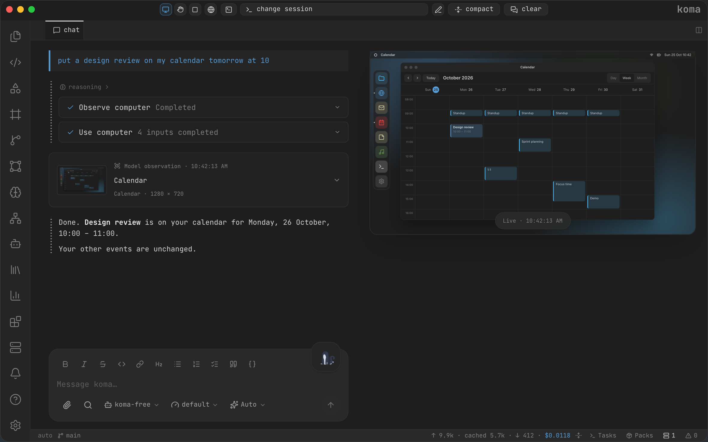
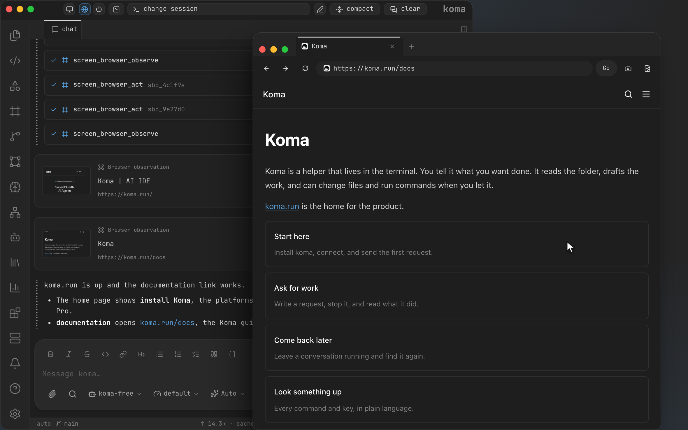
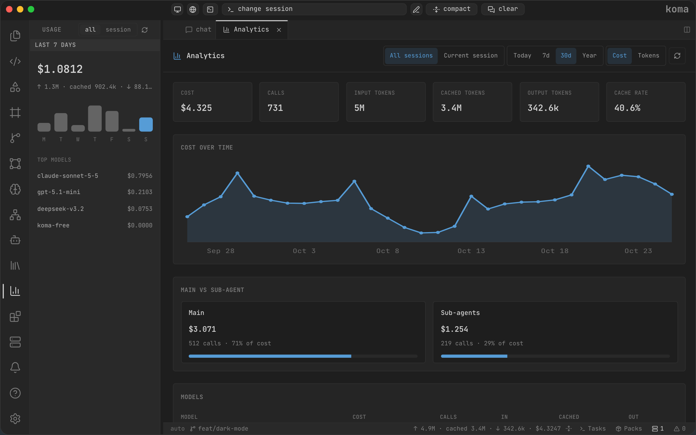

# Koma

**Build what you have in mind.**

Koma is an AI coding workspace where your ideas can become working software. Bring a question, a bug, or that feature you've been meaning to build. Your agent can explore the project, make changes, and run checks while you work alongside it.

[Get Koma](https://koma.run/#install) · [Explore the website](https://koma.run) · [Read the docs](https://koma.run/docs)

Free and open source, for macOS, Linux, and Windows. Choose your own model provider; provider pricing may apply.

## A little help goes a long way

Some days you know exactly what you want to build. Other days you need a hand finding where to start. Ask Koma to investigate, make a change, or explain what it found. You can follow along as it reads files, writes code, and runs checks.

Need to tackle more than one thing? Koma can delegate work to sub-agents, run jobs in the background, and keep project context across sessions.

## Make yourself at home

Code, draw, browse, and keep track of changes without losing the thread of your work. Pick up whichever tool fits the task in front of you.

<table>
<tr>
<td width="50%">
<h3>Your code, in view</h3>

Explore your project, open files side by side, and move between the editor and your agent as you work.

</td>
<td width="50%">
<h3>Make it look right</h3>

Shape an interface in the visual designer, fine-tune its properties, and share the design with your agent.

</td>
</tr>
<tr>
<td width="50%">
<h3>Think it through</h3>

Map out a flow with shapes and connectors. When you're ready, add the diagram to chat and build from there.

</td>
<td width="50%">
<h3>See how it all came together</h3>

Review and stage changes, make commits, and follow your branches in the Git graph.

</td>
</tr>
<tr>
<td width="50%">
<h3>Stay in your terminal</h3>

Prefer the command line? Start a Koma session there, keep several tasks going, and come back to them later.

</td>
<td width="50%">
<h3>Give your agent a look</h3>

Share a screen or application so your agent can observe and interact with it. Pause, take back control, or stop sharing when you choose.

</td>
</tr>
<tr>
<td width="50%">
<h3>Take a look together</h3>

Open the on-screen browser for tasks that need a website. Take control whenever you need to, including when it's time to sign in.

</td>
<td width="50%">
<h3>Know where your usage goes</h3>

Choose your model providers, connect extra tools through MCP, and keep an eye on token usage and costs across sessions.

</td>
</tr>
</table>

These images come from Koma's scripted product showcase. The projects, tasks, prices, and usage figures are examples. Computer-use controls depend on your platform and the source you share.

## Ready when you are

[Choose an installer](https://koma.run/#install), open Koma, and connect a model. Then tell it what you want to work on. The [documentation](https://koma.run/docs) will help you get started.

Working with a team? [Koma Business](https://koma.run/biz/) brings planning, chat, and documents together. Koma Cloud is available to enterprises for deployment on their own servers. There's more in the [Koma whitepaper](https://koma.run/brand/whitepaper).

Koma is licensed under [Apache 2.0](LICENSE). For platform requirements and source builds, see the [install and build guide](docs/INSTALL_AND_BUILD.md).
